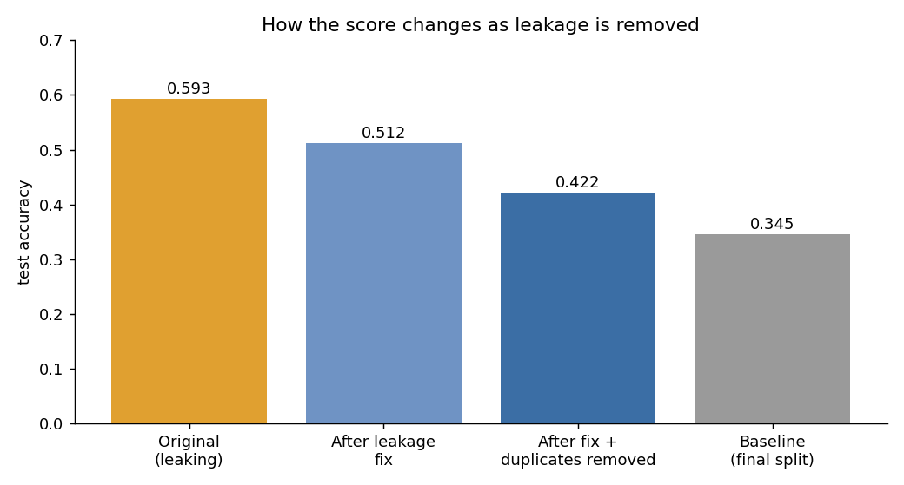
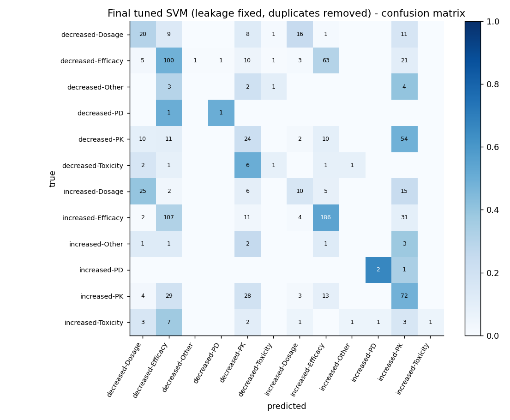

<h1 align="center">Pharmacogenomics ML Data Analysis</h1>

<p align="center">
Data analysis and machine-learning classification of <b>drug effects from genetic variants</b>.
</p>

<p align="center">
  
  
  
  
  
</p>

> This project was done in **April–May 2025** in one of the research labs at Sharif University of Technology.

---

## At a glance

| | |
|---|---|
| **Question** | Can the effect a genetic variant has on a drug (e.g. `increased-Efficacy`, `decreased-Dosage`) be predicted from the variant, gene, drug and consequence? |
| **Data** | 4,698 variant-drug records, 406 drugs, 605 genes, 21 consequence types, **12 imbalanced classes** |
| **Model** | SVM (linear, then tuned RBF with `GridSearchCV`) compared with a most-frequent-class baseline |
| **Result** | **42.2 % accuracy** vs 34.5 % baseline (weighted F1 0.42, macro F1 0.29) |
| **Key lesson** | The first run reported **59.3 %**; after removing data leakage and duplicate rows the honest figure is **42 %** |

## Results

| Model | Test accuracy | Weighted F1 | Macro F1 |
|---|---|---|---|
| Baseline - always the most frequent class | 0.345 | 0.177 | - |
| SVM in the first version (**with leakage**) | 0.593 | 0.503 | - |
| Linear SVM, leakage fixed, duplicates removed | 0.41 | 0.38 | 0.20 |
| **Tuned SVM, final (RBF, C=10)** | **0.422** | **0.417** | **0.29** |

<p align="center"></p>

The model beats the baseline by about 8 points, mostly on the large classes (`increased-Efficacy` F1 0.60, `decreased-Efficacy` 0.42).
Rare classes (`PD`, `Other`, `Toxicity`) are almost never predicted. The commonest mistake is the *direction* of an efficacy effect:

<p align="center"></p>

More in [`docs/findings.md`](docs/findings.md); per-class numbers are in [`reports/tables`](reports/tables).

## What I found in the data

* **Imbalance:** the largest class holds 32 % of the rows, the smallest two only 5 and 7 rows.
* **30 % duplicates:** 1,403 rows are exact copies of other rows (removed before modelling).
* **Ambiguity:** 12.5 % of variant-drug pairs appear with more than one effect.
* **Concentration:** a few drugs and genes dominate (e.g. warfarin 442 rows, ABCB1 352 rows).

<p align="center">
  
  
</p>
<p align="center"></p>

## The data-leakage story

Data leakage means information the model could not have at prediction time reaches the features, so the test score is too good.
Four problems were in the first version of the notebook:

1. a numeric encoding of the **label itself** stayed among the features;
2. the drug/gene/consequence statistics were computed on the **whole table before the split**;
3. the scaler was **re-fitted on the test set**;
4. **30 % of the rows are exact duplicates**, so copies sat in both train and test.

Fix: drop the label-derived column, recompute the statistics from training rows only (one new cell after the split) and use `transform` on the test set and remove the duplicate rows before the split.
Everything else in the notebook is unchanged. Full explanation: [`docs/data_leakage_audit.md`](docs/data_leakage_audit.md).
The git history shows the original notebook in the first commit and the fixes in the following ones.

## Repository structure

```
.
├── data/
│   ├── raw/VarDrug.csv                  # the data set, unchanged
│   └── README.md                        # data dictionary and quality notes
├── notebooks/
│   ├── 00_svm_warmup_iris.ipynb         # warm-up: SVM on the iris data set
│   └── 01_side_effect_classification_svm.ipynb   # main analysis
├── reports/
│   ├── figures/                         # 7 plots
│   └── tables/                          # per-class report, class counts, top drugs / genes / consequences
├── docs/
│   ├── methodology.md                   # pipeline, metrics, threats to validity
│   ├── findings.md                      # results and conclusions
│   ├── data_leakage_audit.md            # what was wrong and what changed
│   ├── model_card.md                    # intended use and limits of the model
│   └── glossary.md                      # pharmacogenomics and ML terms
├── CITATION.cff
├── LICENSE
└── requirements.txt
```

## Run it

```bash
git clone https://github.com/ftharir/pharmacogenomics-ml-data-analysis.git
cd pharmacogenomics-ml-data-analysis
pip install -r requirements.txt
jupyter notebook notebooks/01_side_effect_classification_svm.ipynb
```

The notebook reads `../data/raw/VarDrug.csv`, i.e. relative to the `notebooks/` folder. The grid search takes a few minutes.
Comments and text in the notebook are partly in Persian.

## Limitations

* The category statistics inside the training set are computed on the same rows the model trains on (mild over-fitting; the test set is not affected).
* One random split only; no repeated or grouped cross-validation.
* Rare classes have too few examples for a reliable estimate.
* The model is a learning exercise and **must not be used for clinical decisions** (see the [model card](docs/model_card.md)).

## Ideas for the next version

- [ ] report macro-F1 as the main metric
- [ ] split grouped by drug to test generalisation to unseen drugs
- [ ] stratified repeated cross-validation
- [ ] merge the very rare classes
- [ ] compare with gradient boosting and richer gene/drug descriptors

## Data and licence

The notebooks, documents and figures are released under the [MIT licence](LICENSE).
`data/raw/VarDrug.csv` was provided to me for a research task and its original source is not documented; **it is not covered by the MIT licence**
and is included only so the analysis can be reproduced. If you know the source or hold rights to it and want it credited or removed, please open an issue.
To cite this work, see [`CITATION.cff`](CITATION.cff).
