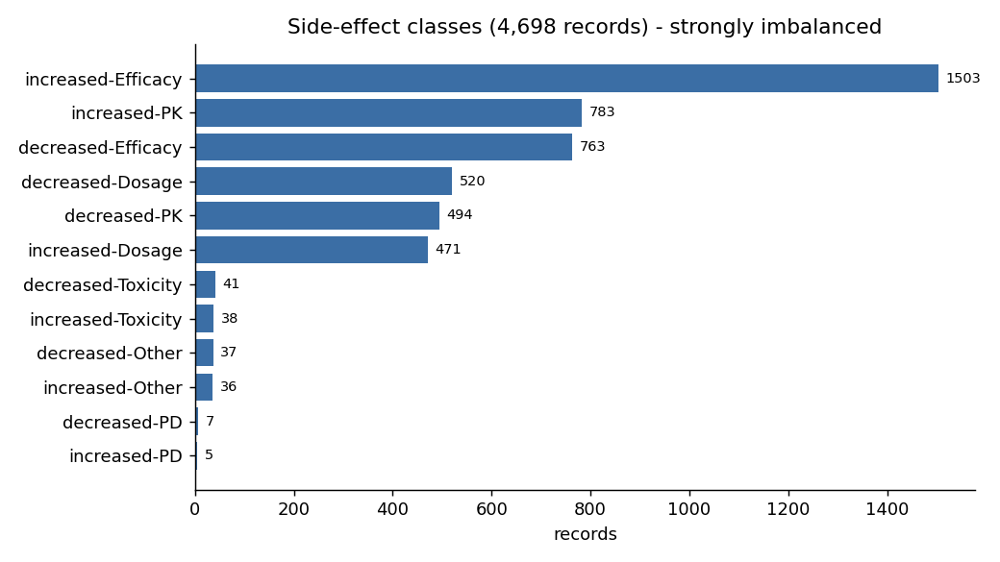
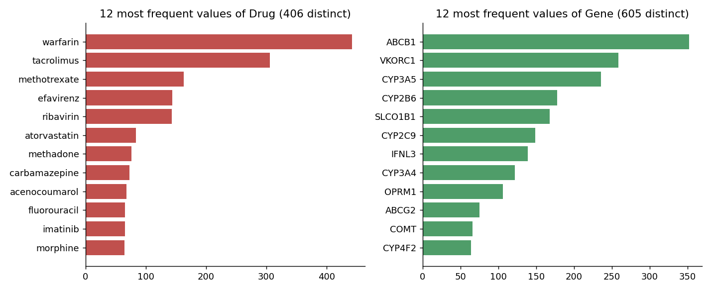
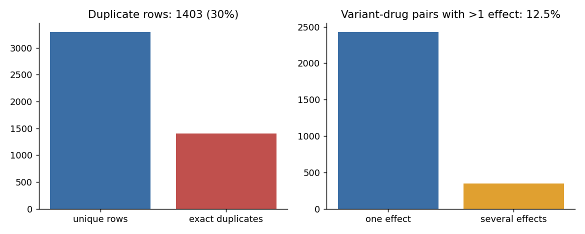
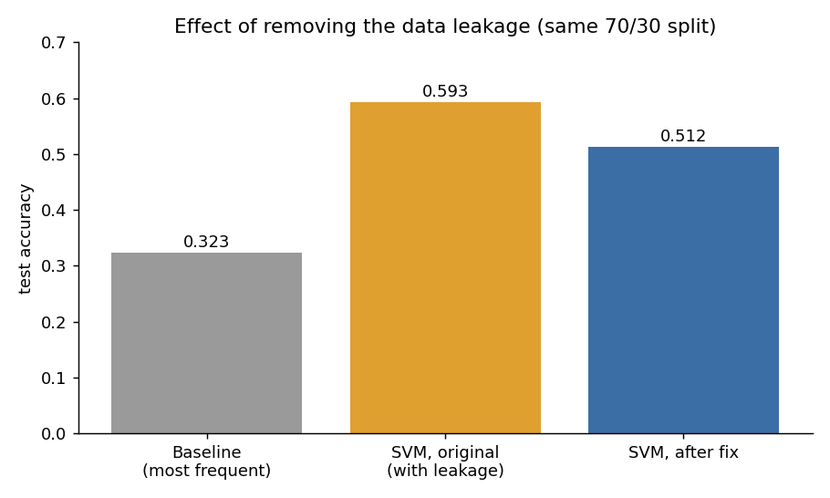
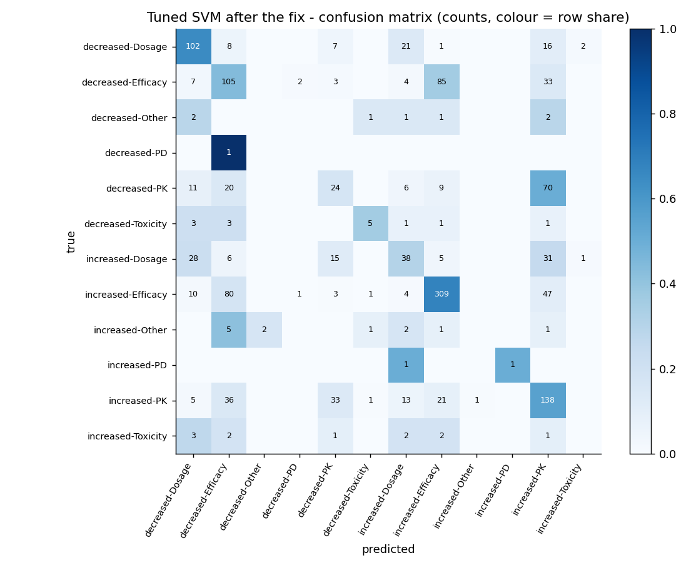

# Pharmacogenomics ML Data Analysis

Data analysis and machine-learning classification of **drug side effects / response from genetic variants**.
Given a variant, its gene, the drug and the variant's molecular consequence, an SVM predicts one of 12 effect classes
(for example `increased-Efficacy`, `decreased-Dosage`, `increased-PK`).

> **Timeline.** Worked on between **26 April and 11 May 2025** (dates of the original files), as a research-style task.
> In **October 2026** I reviewed it, found a data-leakage problem in my own pipeline, fixed it with
> a few small edits and added the figures and notes in this repository. The notebook itself is my original work.

## Repository structure

```
.
├── data/
│   ├── raw/VarDrug.csv                  # the data set, unchanged
│   └── README.md                        # data dictionary and quality notes
├── notebooks/
│   ├── 00_svm_warmup_iris.ipynb         # warm-up: SVM on the iris data set
│   └── 01_side_effect_classification_svm.ipynb   # main analysis (my code)
├── reports/
│   └── figures/                         # 7 plots: data analysis and results
└── docs/
    ├── findings.md                      # results table and conclusions
    ├── data_leakage_audit.md            # what was wrong and what changed
    └── glossary.md                      # pharmacogenomics / ML terms
```

The main notebook (Persian comments and text) covers EDA, feature encoding, SVM, GridSearchCV, evaluation and the baseline comparison.

## The data

* 4,698 rows, no missing values, **12 classes**, 406 drugs, 605 genes, 21 consequence types.
* **Strong class imbalance:** the biggest class (`increased-Efficacy`) holds about 32 % of the rows, the smallest ones only a handful.
* **1,403 rows (30 %) are exact duplicates**, and 12.5 % of the variant-drug pairs appear with more than one effect.





## Method (as in the main notebook)

1. Exploration: types, value counts, missing values, distributions.
2. Features: frequency encoding of the target, per-category target statistics for `Drug`, `Gene` and `Conequence`, label encoding of the alleles parsed from `VariantID`.
3. 70/30 train/test split (`random_state=42`), standardisation, linear SVM, then GridSearchCV over `C`, `kernel` and `gamma` (5-fold).
4. Evaluation: accuracy / weighted precision / recall / F1, confusion matrix, comparison with a most-frequent-class baseline.

## Results and the data-leakage fix

My first version reported **59.3 % accuracy**. That number was too optimistic: part of the information about the test labels
had reached the features. After the fix the same pipeline gives:

| Model | Test accuracy | Weighted F1 |
|---|---|---|
| Baseline (always the most frequent class) | 0.323 | 0.158 |
| SVM, first version (with leakage) | 0.593 | 0.503 |
| **SVM, after the fix (best of the grid: RBF, C=100)** | **0.512** | **0.504** |





The model still clearly beats the baseline, but the honest figure is about **51 %**, not 59 %. Details and the three
one-line changes are in [`docs/data_leakage_audit.md`](docs/data_leakage_audit.md); the full results discussion is in [`docs/findings.md`](docs/findings.md).

### Known limitations

* The 30 % duplicate rows are still in the data, so identical rows can fall into both train and test; scores remain somewhat optimistic.
* Rare classes (fewer than 15 test rows) are almost never predicted correctly; macro-averaged scores would be much lower than the weighted ones above.
* Only variant-level categorical information is used, so the model learns mostly drug/gene statistics, not biology.

## Run it

```bash
pip install pandas numpy scikit-learn matplotlib seaborn jupyter
jupyter notebook notebooks/01_side_effect_classification_svm.ipynb
```

The notebook reads `../data/raw/VarDrug.csv`, i.e. relative to the `notebooks/` folder.

## Data and licence

`VarDrug.csv` was provided to me for a research task; its original source is not documented. It is included only so the analysis can be reproduced.
If you know the source or hold rights to it and want it credited or removed, please open an issue.
